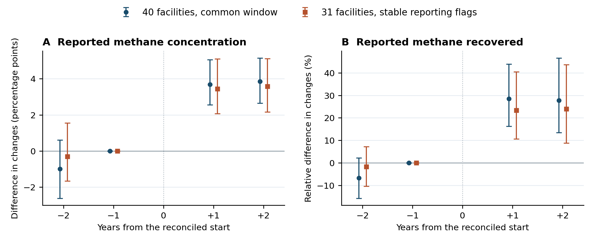
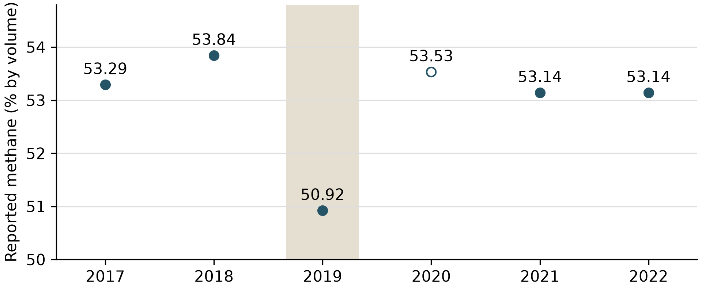
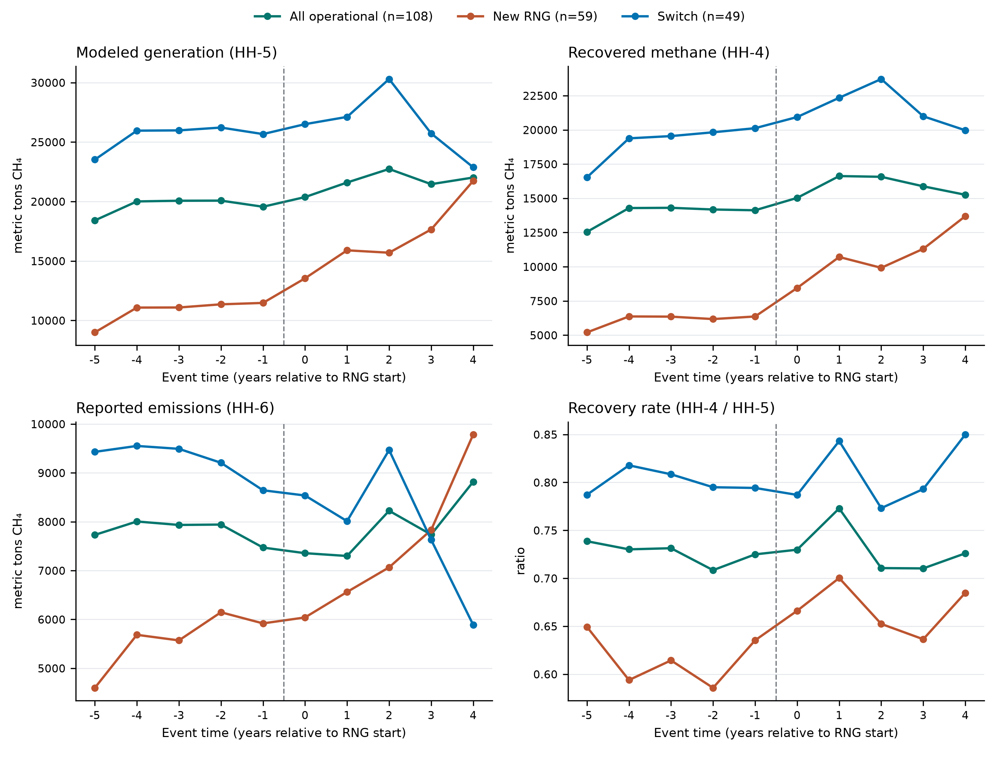
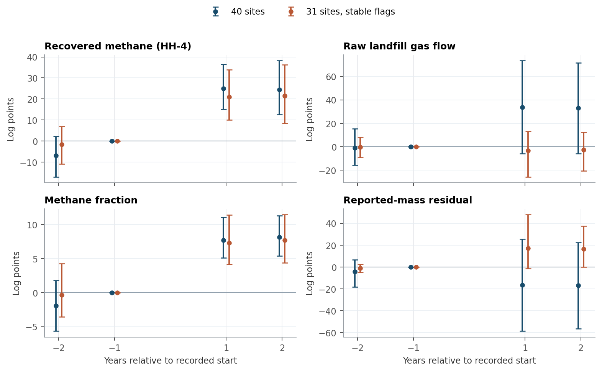

# Pipeline Proximity and the Deployment of Landfill Renewable Natural Gas in the United States

*Research manuscript for review | Version 1.6 | 18 November 2026*

## Abstract

We linked the US Environmental Protection Agency's landfill project registry to mapped natural gas pipelines and public records of operation to examine where pipeline-injection renewable natural gas (RNG) projects start. In a retrospective panel of 114 deployments at 1,317 landfills, doubling distance to the nearest mapped interstate pipeline was associated with 0.85 times the conditional annual odds of deployment (95% spatial interval, 0.77 to 0.94). The association persisted across spatial cutoffs of 25–400 km. We then linked the same deployment ledger to facility gas collection reports. Among 40 facilities with complete data for the same event window, the average difference in changes relative to controls over the first two years after the assigned start was +3.77 percentage points for reported methane concentration and +28.08% for reported methane recovery. Among 31 facilities with stable reporting flags, the corresponding differences were +3.51 percentage points and +23.65%. Estimates of collected-gas volume differed between samples. In a 39-facility sensitivity analysis, intervals for both methane outcomes spanned zero when post-start departures from parallel trends could match the largest pre-start departures.

**Keywords:** landfill gas, renewable natural gas, pipeline injection, project registry, spatial dependence

## Introduction

Landfill gas can be flared, used to generate electricity or heat, or upgraded to renewable natural gas for delivery by pipeline or another route. These uses share a source of gas but involve different equipment and connections. Distance to a mapped natural gas line provides a way to characterize the geography of potential pipeline access. The costs and feasibility of interconnection also depend on the actual delivery point, route, pressure, capacity, and arrangements with the network operator. Work on US dairy digesters has already considered distance to pipelines alongside farm size and geography [1]. The question here is how much the landfill association depends on whether registry entries correspond to operating events within the study window.

The US Environmental Protection Agency (EPA) Landfill Methane Outreach Program (LMOP) database reports landfill characteristics and projects at different stages of development [2,3]. A start year attached to a project still listed as planned can describe an anticipated date or a date that precedes a status update. A project recorded as shut down may have operated earlier. Grouping those records by status alone can omit projects that began operating and include projects that did not. We quantify how a targeted reconciliation changes the deployment event set and examine whether the distance association persists under the revised labels.

The same deployment records also provide a date around which to examine how facilities report the gas they collect. Scarpelli et al. [4] found higher reported methane concentrations in years with operating RNG projects at five high-emitting Texas landfills. Their study also examined airborne emissions, a separate outcome. We extend the reporting comparison across multiple deployment cohorts and examine concentration, gas volume, and recovered methane in the same facilities and years.

We ask where pipeline-injection RNG projects deploy in relation to mapped pipelines and how reported gas collection changes around those deployments. The reconciled event ledger defines both the timing of deployment in the siting analysis and the comparison years in the reporting analysis.

## Data and Methods

We first estimated the association between mapped pipeline distance and deployment in a landfill-year hazard model. We then used the reconciled event years from that model to align facility-level gas collection reports.

### Landfill registry and mapped pipelines

We used the September 2024 LMOP composite workbook and the Homeland Infrastructure Foundation-Level Data map of interstate and intrastate natural gas pipelines [2,5]. We treated the landfill as the deployment unit and aggregated project records by Landfill ID. We retained mapped sites in the contiguous United States with valid coordinates, a usable pipeline distance, positive waste in place, and a recorded opening year. We excluded sites whose dated pipeline-injection projects all preceded 1995. After these filters, 1,821 sites qualified for the retrospective panel before any model-specific state exclusions.

We measured distance in kilometres from LMOP site coordinates to mapped pipeline segments. For the 29-state interstate analysis, we verified the shortest spherical distance over the entire interstate layer. We screened segments using their spherical midpoints and a triangle-inequality bound, then computed the minimum point-to-arc distance. The other pipeline distance variants used the original geographic candidate search. Distance and waste in place were log transformed and held constant across years using their respective snapshots. The exposure measures proximity to mapped infrastructure. Connections through a lateral, gathering or distribution lines, and gas delivered by truck may follow different routes or be absent from the map.

### Event definitions and external records

The two original definitions took the earliest valid 1995–2024 start year for a pipeline-injection project under each status rule. One admitted Operational and Shutdown records. The broader rule also admitted Planned and Construction records. We audited project records using publicly available regulatory filings, operator statements and other dated records. For each review, the evidence table distinguishes the operating event described by the source from the analysis year assigned to the landfill. Evidence of a planned date, construction or a later expansion is kept separate from evidence of operation.

The first audit was a stratified draw of 30 out of 145 landfills with a valid registered pipeline-injection start year. Strata combined three eras with status and prior energy use, and the sampling scheme gave some strata higher inclusion probabilities. We report unweighted counts within this audit. A second review covered the 36 landfills in the audit frame with no pipeline-injection record listed as Operational or Shutdown. The two reviews share 10 Landfill IDs. The second review supplied corrections to the event ledger. Lemons and Quad Cities had no assigned event year in the final fitted ledger. Sites with unresolved records were treated as event-free through the study window in this specification.

A separate audit of delivery routes used the 78 of 114 deployment sites present in the LMOP snapshot issued two calendar years before each site's assigned start [2]. We crossed three bands of mapped interstate distance (below 3.165 km, 3.165–22.071 km, and above 22.071 km) with the presence of a dated prior landfill-gas electricity project in that snapshot. We retained six pilot sites and randomly drew additional sites within each stratum to reach five sites per stratum. We compared the system named for the closest mapped segment with the first commercial gas network documented to receive the upgraded RNG, including connections via dedicated laterals. We recorded trucked deliveries separately and treated proposed or permitted routes without evidence of operation as unresolved. The timing record distinguishes first documented commercial delivery, evidence that delivery had occurred by a given date, and milestones such as plant commissioning and opening ceremonies.

### Deployment model and spatial uncertainty

We constructed landfill-years from the later of opening and 1995 through the assigned event year or administrative censoring in 2024. A landfill with an assigned event before entry supplied no at-risk observations under the implemented rule. The discrete-time logit estimated the conditional annual odds of the recorded or reconciled pipeline-injection event among landfills still at risk under these rules. The specification included log distance, log waste in place, state indicators, and calendar-year indicators for years with events, with other years pooled as the reference. States without outcome variation were omitted. This construction means that changing the event definition can change state inclusion as well as the timing of risk-set exits.

We report landfill-clustered standard errors and spatial standard errors calculated from the landfill-level sums of logit scores. The spatial covariance uses a Bartlett kernel with weights declining linearly to zero at cutoffs of 25, 50, 100, 200 and 400 km [6]. We show the 100 km interval in the text and report the range across the five cutoffs. The odds ratio for a doubling of distance is exp(β × ln 2). These uncertainty estimates address the specified spatial dependence. The distance association also depends on the adequacy of the model and its snapshot covariates.

The logit was fit by iteratively reweighted least squares with a small ridge penalty (λ = 10⁻⁶) for numerical stability. The intercept and calendar-year coefficients absorb baseline-hazard heterogeneity. In the alternative maximum-likelihood fit on the original distances, the full information-matrix condition number was approximately 5 × 10⁵ with the waste-in-place control and 1 × 10⁴ without it.

### Facility-reported methane around reconciled starts

We linked the deployment ledger to the 2010–2023 Greenhouse Gas Reporting Program (GHGRP) Subpart HH gas collection panel through LMOP's GHGRP facility identifiers [7]. The panel contained 12,176 facility-years for 1,040 facilities, of which 1,038 matched LMOP. The outcomes were the reported annual volume of collected landfill gas, its reported average methane concentration, and annual recovered methane calculated under Equation HH-4. A landfill, an energy project, a GHGRP facility, and a gas stream can have different boundaries.

For each deployment in the reconciled ledger, we required all three outcomes to be positive and available in event years −2, −1, +1, and +2, with concentrations at most 100%. We omitted event year 0 because annual reports can span months on either side of the start. The comparator pool contained 823 GHGRP facilities with no linked LMOP record of RNG. Following the group-time approach of Callaway and Sant’Anna [8], we compared changes from event year −1 with changes over the same calendar years among comparators with complete data for that cohort's window. We weighted cohorts by the number of deploying facilities and averaged years +1 and +2 with equal weight. Within each specification, all outcomes used the same facilities, dates, and weights. We estimated concentration differences in percentage points and back-transformed contrasts in log gas volume and log recovered methane to percent changes. Pointwise 95% intervals were based on 1,999 facility bootstrap draws, resampling deploying facilities within cohorts and sharing a draw of comparator weights across cohorts.

We repeated the comparison among deploying facilities with complete and unchanged wet- or dry-basis flags for both gas volume and concentration and unchanged temperature and pressure correction flags. Gas volume and concentration had to use the same basis in each year. The primary restriction retained the original comparators for each cohort. A further check applied the same flag criteria to comparators. We decomposed the contrast in log reported recovered methane into log volume, log methane fraction, and a remainder that captures differences between the reported HH-4 mass and a calculation based on the annual volume and fraction (Supplementary Information).

We assessed sensitivity to differential trends by extrapolating the change between the two pre-start years and, separately, by applying the Rambachan–Roth relative-magnitude restriction with the authors' HonestDiD implementation [9]. The latter required complete data from event years −3 through +2. The coefficient for year 0 entered the sensitivity calculations with zero weight in the target average. We report 95% intervals for bounds of zero, one-half, and one times the largest pre-start departure from parallel trends in adjacent-year changes.

Two purposively selected pairs, Coastal Plains and Camelot in Texas and Roosevelt and LRI 304th Street in Washington, were reviewed to assess comparability. We compared public facility-year summaries with the frozen panel, recorded dated changes in equipment and downstream use, and searched for historical analyzer and branch diagrams and the inputs to annual averages. We used separate evidence for commercial operation, earlier shutdown or conversion, and the point where methane concentration was measured.

We audited two sites with large contributions to the decomposition, Douglas County and Timberlane. We cross-checked the analysis fields against public e-GGRT annual reports and facility-level Envirofacts exports, compared the facility HH-4 totals with the reported quantities by measurement location, and checked their scale against the annual gas volume. We repeated the common-window comparison after omitting each site separately and both together, retaining the original event years and comparison facilities for each cohort.

## Results

### Reconciliation of pipeline injection events

In the stratified sample of 30 landfills, 19 records were classified as consistent with external evidence, ten had a status or operating-event discrepancy, and one remained uncertain. All ten discrepancies occurred among the sampled sites without an Operational or Shutdown pipeline-injection record. Four had no qualifying operating event in the relevant classification, and six were in operation despite the earlier status. The 10 of 29 figure is the observed fraction among resolved cases in this sample. Unequal inclusion probabilities and the unresolved record limit its use as a population estimate.

The review of all 36 sites in the targeted registry group classified 22 as late operating, 11 as ineligible or supported by evidence for exclusion, and three as unresolved. The revised labels brought the two original event definitions to a single reconciled set. The final event ledger used for the primary analysis contains 114 events across 29 states (115 events when California is retained). Both reconciled specifications use the same set of assigned event years.

**Table 1. Deployment estimates by event definition**

| Event definition | Landfill-years | Events | Log-distance coefficient | Landfill-clustered p |
| --- | ---: | ---: | ---: | ---: |
| Original broad status rule | 47,076 | 144 | −0.184 | 0.004 |
| Original Operational or Shutdown rule | 38,107 | 108 | −0.171 | 0.018 |
| Reconciled event labels | 38,071 | 114 | −0.142 | 0.057 |

All rows use the state-adjusted model. Because states without outcome variation are omitted separately, these are comparisons across specifications and their available samples.

### Pipeline proximity and deployment

Proximity to mapped interstate transmission lines was the primary geographic association. Distance to the nearest mapped interstate pipeline had a log-distance coefficient of −0.234 (landfill-clustered p < 0.001). The corresponding odds ratio for a doubling of distance was 0.85 (95% spatial interval at 100 km, 0.77 to 0.94). Spatial HAC p-values were below 0.002 at every cutoff from 25 to 400 km.

Public records identified the operating delivery route for 13 of the 30 audited sites. Three projects delivered to the nearest mapped interstate system, nine to another pipeline or utility network, and one trucked RNG to an off-site receiving point. The route remained unresolved at 17 sites (Table S3). At Roosevelt, a dedicated Klickitat Public Utility District line connected the project to Williams Northwest, the nearest mapped interstate system [10]. The Eagle Ridge landfill coordinate was about 0.01 km from the mapped Rockies Express alignment. The project delivered to Panhandle Eastern [11]. The nearest mapped interstate line to Keystone was Transcontinental Gas Pipe Line (22.93 km), and the project delivered to the UGI Utilities distribution network [12]. At Foothills, 47.45 km from the nearest mapped interstate line, the operator transported the upgraded gas by truck to a receiving point on the local gas network [13].

The full-layer search shortened the distance at 11 landfills, including one deployment site, and changed the odds ratio by less than 0.001. In a separate maximum-likelihood fit using the original distances, dropping the waste-in-place control gave an odds ratio of 0.86 (0.80 to 0.93). For 66 of the 114 events, the date of the waste-in-place snapshot followed the registered start, so reported size could reflect changes since deployment.

The 114 events over 38,071 at-risk landfill-years give a crude annual deployment rate of about 0.30%. Comparing the 25th and 75th percentiles of mapped interstate distance (3.2 and 22.1 km) gives an odds ratio of 0.634 (95% landfill-clustered interval, 0.487 to 0.827). Applying that odds ratio to a hypothetical site with the cohort's crude annual rate gives an illustrative change from 0.30% to 0.19%.

The estimated coefficient for distance to an intrastate line was +0.009 (p = 0.91). In the comparison of pipeline types using the original distances, dropping the waste-in-place control gave an interstate-minus-intrastate coefficient difference of −0.092 (95% interval, −0.27 to +0.09). The gathering-line layer contained 69 mapped segments.

The specification for all mapped lines included 1,317 landfills and yielded a log-distance coefficient of −0.142 (landfill-clustered p = 0.057). The odds ratio for a doubling of distance was 0.906 (95% spatial interval at 100 km, 0.811 to 1.012, p = 0.081). Across the five cutoffs, p ranged from 0.047 to 0.081. The original Operational or Shutdown model contained 1,319 landfills and estimated a coefficient of −0.171. Reconciliation changed both event labels and the available model sample.

**Table 2. Distance association by mapped pipeline type**

| Pipeline type | Log-distance coefficient | Landfill-clustered p | Odds ratio per doubling (95% CI) |
| --- | ---: | ---: | ---: |
| Interstate | −0.234 | <0.001 | 0.85 (0.77–0.93) |
| All mapped lines | −0.142 | 0.057 | 0.906 (0.819–1.003) |
| Intrastate | +0.009 | 0.91 | 1.01 (0.91–1.12) |
| Gathering | −0.597 | 0.014 | 0.66 (0.48–0.92) |

All rows use the reconciled 114-event specification with state fixed effects and landfill-clustered standard errors. Interstate is the primary specification; the headline spatial (Conley) interval for the interstate coefficient is reported in the text.

### Methane reported before and after reconciled starts

Forty of the 114 reconciled deployment events met the common-window requirements, spanning nine start years between 2013 and 2021. Across cohorts, 685 distinct comparison facilities contributed data. Reported methane concentration and recovery rose relative to the comparator changes in both post-start years (Figure 1). The two-year average was +3.77 percentage points for concentration and +28.08% for recovery. The estimates were similar among the 31 deploying facilities with stable reporting flags (Table 3).

**Table 3. Average differences in changes in reported gas collection in event years +1 and +2**

| Reported outcome | 40 facilities, common window | 31 facilities, stable reporting flags |
| --- | ---: | ---: |
| Methane concentration, percentage points | +3.77 (2.63 to 5.07) | +3.51 (2.16 to 5.09) |
| Recovered methane (HH-4), % | +28.08 (15.27 to 44.48) | +23.65 (10.14 to 41.63) |
| Collected landfill gas volume, % | +39.70 (−4.49 to 106.04) | −2.92 (−19.68 to 13.03) |

Parentheses show 95% facility bootstrap intervals. Within each column, the same records and weights are used for all three outcomes. The 31-facility analysis uses the same comparator rule as the 40-facility analysis.

**Figure 1. Reported methane concentration and recovery around reconciled RNG starts.** Points show differences in changes from event year −1 and bars show pointwise 95% facility bootstrap intervals. The start year is omitted. Estimates use the group-time comparison and the same event window as Table 3.

The collected-gas volume estimate was imprecise in both samples. Decomposing recovery showed a similar concentration component across samples and different contributions from volume and the remainder (Table S2 and Figure S2).

Both reported methane outcomes were sensitive to trend assumptions. Extrapolating the difference in pre-start trends in the 40-facility sample gave estimates of +1.28 percentage points for concentration and +7.57% for recovery, with both intervals spanning zero. In the 39-facility sensitivity sample, the intervals also spanned zero when the permitted post-start departures from parallel trends matched the largest pre-start departures (Table S1).

### Measurement comparability

Twelve of the 30 route-audit sites contributed to the 40-facility comparison. One had a documented first commercial delivery date and seven had evidence of delivery by a specified date. At Keystone, the operator documented the introduction of RNG into the pipeline at commercial startup on 30 December 2021 [14]. At Southeast OKC, ONEOK documented delivery into its pipeline by August 2018, ahead of the 24 September activation ceremony [15,16]. The two cases provide dated milestones within their assigned start years. We used the delivery records to check individual case histories within the reconciled annual window.

At Coastal Plains, electricity generation stopped in May 2019 and commercial RNG production began in September 2020 [17]. Relative to the 2017–2019 mean of 52.683%, the facility's mean reported concentration in 2021–2022 changed by **+0.457 percentage points**; relative to the 2017–2018 mean of 53.565%, it changed by **−0.425 percentage points**. The sign reversal shows that this single-facility description depends on how the operating transition is placed in the window (Figure 2).

**Figure 2. Coastal Plains annual reported methane concentration.** Shading identifies 2019, the year electricity generation ended. The commercial RNG start year (2020) is excluded from both baseline calculations and from follow-up. Points are public annual values for collected landfill gas.

In the paired-site audits, public summaries agreed with the frozen data for all 24 facility-years, but the available underlying records did not permit reconstruction of the reported annual concentration for any of them. At Roosevelt, label ML 3 was associated with the former power plant in 2018 and with the RNG branch in 2019 [18,19]; the available permit and later flow diagram do not connect that label to the physical analyzer and upstream gas stream across both years [20]. At LRI, county permits identify a gas management plan and an operating plan, and annual reports document measurements from subsurface migration probes and the installation of extraction wells, but do not connect those observations to the collected-gas measurements entering the federal annual average [21]. Differences in the measured gas stream or in how annual concentrations were compiled could therefore contribute to an apparent change.

At Douglas County, the annual gas volume in standard cubic feet (scf) and the HH-4 recovered methane in metric tons had identical numerical values in each year from 2012 through 2014 [22]. In 2014, the sole listed measurement location was the flare inlet. The report paired 2,894 scf with 2,894 metric tons of recovered methane. At standard conditions, 2,894 scf of pure methane would weigh about 0.056 metric tons (Tables S4 and S5). Douglas County accounted for 29.04 of the 33.43 log points (86.9%) in the 40-facility volume contrast. Omitting the site reduced the contrast from +39.70% to +4.61% (95% interval, −11.19% to +19.59%) (Table S7).

At Timberlane, the high-Btu project and flare were listed as separate measurement locations in 2020 and 2021. The high-Btu project accounted for 99.5% and 97.7% of the facility HH-4 totals, respectively [23]. On a common standard-volume basis, even if the reported gas volumes consisted entirely of methane, they could account for less than 5% of the HH-4 total in each year (Table S8). The methane masses implied by the reported volumes and annual average concentrations were close to the flare's reported recovery, suggesting that the annual volume field may cover the flare alone (Table S6). The landfill's monitoring report for the second half of 2021 documents a dedicated flare flow monitor and lists flare shutdowns during third-party landfill gas use (Table S9). Verifying the coverage of the volume field requires calendar-year flow totals at both inlets. Timberlane met the stable-flag criteria and contributed 12.77 of the 16.67 log points (76.6%) in the reported-mass remainder for the 31-facility comparison. Omitting Timberlane reduced the remainder to 4.03 log points (Table S7).

With both sites omitted, the 38 remaining deployment sites had a concentration contrast of +3.11 percentage points (95% interval, 2.37 to 3.91) and a recovered-methane contrast of +22.50% (95% interval, 13.55% to 32.25%), using the original cohort-specific comparators. Table 3 reports the full common-window estimates, and Table S7 reports the exclusions as sensitivity analyses.

## Discussion

Closer proximity to mapped interstate pipelines was associated with higher conditional annual odds of pipeline-injection deployment in the eligible registry panel. That geographic gradient encompasses projects with different connection requirements, including dedicated laterals and off-site gas delivery. The comparison of interstate and intrastate coefficients was sensitive to the waste-in-place control. Reconciliation changed the event count, and the interstate coefficient was similar under the original Operational or Shutdown rule. A registry used to study deployment would benefit from separate dated fields for planned start, operating milestones, and status as of the snapshot date.

The retrospective panel uses the 2024 registry to reconstruct past risk sets. As a check on exposure timing, we reconstructed the August 2020 registry frame (2,629 sites) and used four subsequent snapshots to track sites through 31 August 2024. Pipeline distance and waste in place were measured at baseline. The 45 evidence-screened deployment outcomes also appear in the retrospective panel. A doubling of distance to a pipeline mapped in 2020 was associated with an odds ratio of 0.86 (95% spatial interval, 0.76 to 0.96) in the univariate specification and 0.92 (0.79 to 1.07) after controlling for baseline waste in place and region. The two pipeline layers gave similar results. This exercise checks the timing of the measured exposures. The available maps lack annual network construction and interconnection histories, and local gas markets and project siting decisions may also explain the observed proximity gradient.

The common-window comparison extends the higher reported methane concentrations observed at selected Texas landfills [4] to a broader set of deploying facilities compared with contemporaneous controls. The 31-facility check shows a similar concentration difference even when wet- or dry-basis and temperature and pressure correction flags are stable. The case records indicate why those flags only cover part of measurement comparability. At Coastal Plains, the timing of the electricity shutdown affects the choice of baseline. At Roosevelt, the available records show a change in the branch associated with the reporting label. Both details matter when interpreting a change in the annual concentration as a change in the composition of a particular gas stream.

Reported recovery increased relative to controls under parallel trends, with substantial uncertainty about the increment once differential trends were allowed. The case audits show how inconsistencies between the reported volume and mass can shift the share of the contrast attributed to gas volume in the decomposition (Tables S2 and S7). The HH-4/HH-5 ratio uses modeled generation and therefore provides limited evidence on changes in physical capture efficiency. Evaluating atmospheric methane emissions or net mitigation requires evidence on methane outside the reported collection stream and the fate of recovered gas.

## Conclusion

Pipeline-injection RNG deployments were more common near mapped interstate pipelines in the reconciled landfill registry. Reconciliation of planned and operating dates changed which events counted as deployments and provided the dates for examining facility reports. In the common event window, reported methane concentrations were higher after those starts, including among facilities with stable reporting flags. The estimated difference in recovered methane depends on assumptions about pre-start trends, and the gas volume data leave its source unresolved. Dated operating milestones and a consistent record of the gas stream being measured would make the deployment and reporting records more informative when used together.

## Data and Code Availability

The source data are the EPA LMOP September 2024 composite file, the public HIFLD pipeline layer and the EPA GHGRP Subpart HH reporting table [2,5,7]. Table S3 lists the interconnection records and public sources for all 30 sites in the delivery audit. Tables S4 and S5 provide the annual records and measurement locations for the Douglas County and Timberlane audit. Tables S8–S10 document the Timberlane volume check and review of state filings. The archived inputs, exact commands, model outputs and evidence ledgers used to prepare this draft are indexed in the accompanying provenance note. The current archive is local.

## References

[1] Wehner J, Wolf C, Zhang W. Farm level drivers of anaerobic digester installations on dairy farms across the US. AAEA and WAEA Joint Annual Meeting, Denver, 2025. https://ageconsearch.umn.edu/record/360639

[2] US Environmental Protection Agency. LMOP Landfill and Project Database. September 2024 composite workbook. https://www.epa.gov/lmop/lmop-landfill-and-project-database

[3] US Environmental Protection Agency. Frequent Questions about Landfill Gas. https://www.epa.gov/lmop/frequent-questions-about-landfill-gas

[4] Scarpelli TR, Cusworth DH, Duren RM, et al. Investigating major sources of methane emissions at US landfills. Environmental Science & Technology. 2024, 58(49), 21545–21556. https://doi.org/10.1021/acs.est.4c07572

[5] US Department of Homeland Security. Natural Gas Pipelines. Homeland Infrastructure Foundation-Level Data. https://catalog.data.gov/dataset/natural-gas-pipelines

[6] Conley TG. GMM estimation with cross sectional dependence. Journal of Econometrics. 1999, 92(1), 1–45. https://www.sciencedirect.com/science/article/pii/S0304407698000840

[7] US Environmental Protection Agency. Subpart HH Information Sheet and GHGRP Reported Data. https://www.epa.gov/ghgreporting/subpart-hh-information-sheet

[8] Callaway B, Sant’Anna PHC. Difference-in-Differences with multiple time periods. Journal of Econometrics. 2021, 225(2), 200–230. https://doi.org/10.1016/j.jeconom.2020.12.001

[9] Rambachan A, Roth J. A more credible approach to parallel trends. Review of Economic Studies. 2023, 90(5), 2555–2591. https://doi.org/10.1093/restud/rdad018

[10] Washington Utilities and Transportation Commission. Klickitat PUD standard inspection 8434. Inspection scope and summary, May 2022 inspection. [Inspection report](https://www.utc.wa.gov/sites/default/files/2023-09/8434%20Inspection%20Report.pdf).

[11] Vision RNG and Meridian Waste. Eagle Ridge RNG plant grand opening announcement. 12 October 2023, p. 1. [Project release](https://www.meridianwaste.com/media/359025/vision-rng-celebrates-grand-10-12-23.pdf).

[12] UGI Corporation. UGI Adds Renewable Natural Gas to its Supply Portfolio. 4 January 2022. [Company release reproduced by MarketScreener](https://www.marketscreener.com/quote/stock/UGI-CORPORATION-14738/news/UGI-Adds-Renewable-Natural-Gas-to-its-Supply-Portfolio-37465252/).

[13] Evensol. Foothills Renewables LLC project profile. [Operator portfolio](https://evensol.com/projects/).

[14] Archaea Energy Inc. Form 10-K for the year ended December 31, 2021. Item 1, Project Assai. [SEC filing](https://www.sec.gov/Archives/edgar/data/1823766/000182376622000003/lfg-20211231.htm).

[15] ONEOK. Landfill Gas Energy Project. Project overview, 2019. [Technical presentation archived by EPA](https://19january2021snapshot.epa.gov/sites/static/files/2019-12/documents/landfillgasenergyproject_chaseedmiston.pdf).

[16] Republic Services, Aria Energy and BP. Southeast Oklahoma Landfill RNG project activation announcement. 24 September 2018. [Operator release](https://media.republicservices.com/2018-09-24-Republic-Services-Aria-Energy-and-BP-Celebrate-the-Activation-of-a-Major-Renewable-Energy-Project).

[17] Montauk Renewables, Inc. Form 10-K for the year ended December 31, 2020. Item 1, Coastal Plains. https://www.sec.gov/Archives/edgar/data/1826600/000119312521102560/d103808d10k.htm

[18] US Environmental Protection Agency. Roosevelt Regional Landfill, GHGRP 1003676, reporting year 2018. https://ghgdata.epa.gov/ghgp/html/2018.do?et=undefined&id=1003676

[19] US Environmental Protection Agency. Roosevelt Regional Landfill, GHGRP 1003676, reporting year 2019. https://ghgdata.epa.gov/ghgp/html/2019.do?et=undefined&id=1003676

[20] Washington State Department of Ecology. Roosevelt Regional Landfill Notice of Construction revision application DE90-C153. Appendix C, 2023. https://ecology.wa.gov/getattachment/8b06acfa-7543-44dc-9712-5aa33cadaf84/20230628RLFExpanNOCApp.pdf

[21] Tacoma-Pierce County Health Department. LRI Landfill Permits and Reports. Solid Waste Permit 27-650 and annual monitoring reports. https://tpchd.org/environment/lri-landfill/permits-and-reports/

[22] US Environmental Protection Agency. Douglas County Landfill, GHGRP 1000522. Subpart HH public annual reports. [2012](https://ghgdata.epa.gov/ghgp/html/2012.do?et=undefined&id=1000522), [2013](https://ghgdata.epa.gov/ghgp/html/2013.do?et=undefined&id=1000522), [2014](https://ghgdata.epa.gov/ghgp/html/2014.do?et=undefined&id=1000522).

[23] US Environmental Protection Agency. IESI Timberlane Landfill, GHGRP 1006064. Subpart HH public annual reports. [2019](https://ghgdata.epa.gov/ghgp/html/2019.do?et=undefined&id=1006064), [2020](https://ghgdata.epa.gov/ghgp/html/2020.do?et=undefined&id=1006064), [2021](https://ghgdata.epa.gov/ghgp/html/2021.do?et=undefined&id=1006064).

[24] Code of Federal Regulations. 40 CFR § 98.343, Calculating GHG emissions. 2024 edition. https://www.govinfo.gov/content/pkg/CFR-2024-title40-vol23/pdf/CFR-2024-title40-vol23-sec98-343.pdf

[25] US Environmental Protection Agency. Greenhouse Gas Reporting Program e-GGRT HelpDesk. [FAQ Q389 on multiple measurement locations and destruction devices](https://uat.ccdsupport.com/node/80544146).

[26] Louisiana Department of Environmental Quality. Annual inventories and monitoring reports for Agency Interests 52277 and 212498 listed in Table S9. Timberlane Landfill Title V permit 0060-00063-V7, Specific Requirement 78 (PDF p. 31). [Permit](https://edms.deq.louisiana.gov/edmsv2/doc/view?doc=13013031) and [EDMS public records portal](https://www.deq.louisiana.gov/page/edms).

## Supplementary Information

### Sensitivity to differential trends

**Table S1. 95% intervals under the Rambachan–Roth relative-magnitude restriction**

| Relative-magnitude bound | Reported concentration, percentage points | Reported recovered methane (HH-4), % |
| --- | ---: | ---: |
| 0 | 2.51 to 5.14 | 13.19 to 42.02 |
| 0.5 | −0.09 to 6.51 | 2.46 to 46.70 |
| 1 | −3.10 to 9.41 | −10.21 to 63.95 |

The continuous −3 to +2 window includes 39 deployments and 675 distinct comparison facilities. The bound scales the maximum pre-start violation of parallel trends in adjacent-year changes. Intervals use the conditional least-favorable procedure in HonestDiD 0.2.8 with 1,000 grid points, a covariance matrix from 1,999 facility bootstrap draws and weights of 0, 0.5, and 0.5 for the startup year and next two years, respectively [9]. As a separate check, extrapolating the slope of relative changes from year −2 to −1 gave +1.28 percentage points (−3.51 to 6.29) for concentration and +7.57% (−17.15 to 44.33) for recovery in the 40-facility sample. In the 31-facility sample, the values were +2.76 percentage points (−1.67 to 8.74) and +18.46% (−10.95 to 62.55).

### Reported recovered methane and its components

Let *R* be the reported HH-4 methane mass in metric tons, *Q* the reported annual gas volume in cubic feet, and *f* the reported concentration as a fraction. The nominal annual mass is *Q f ρ*, where *ρ* = 0.0423 × 0.454 / 1,000 metric tons per cubic foot of methane at 60 °F and 1 atm, using the constants from Equation HH-4 [24]. The remainder *K* = *R* / (*Q f ρ*) gives the identity log(*R*) = log(*Q*) + log(*f*) + log(*K*) + log(*ρ*). The same differencing and weighting apply to all terms. Equation HH-4 uses data by measurement period and accounts for temperature, pressure and moisture as applicable. A calculation using published annual fields can differ from the HH-4 inputs in aggregation, corrections and the gas stream covered by each field.

**Table S2. Decomposition of reported methane recovery in event years +1 and +2**

| Component | 40 facilities, common window | 31 facilities, stable reporting flags |
| --- | ---: | ---: |
| Reported HH-4 recovery | +24.75 (14.21 to 36.80) | +21.23 (9.66 to 34.80) |
| Collected landfill gas volume | +33.43 (−4.59 to 72.29) | −2.97 (−21.92 to 12.25) |
| Methane fraction | +7.93 (5.33 to 11.13) | +7.52 (4.37 to 11.35) |
| Remainder, *K* | −16.62 (−57.35 to 23.28) | +16.67 (−0.49 to 42.28) |

Values are 100 times log contrasts, with 95% facility bootstrap intervals in parentheses. The last three point estimates sum to the first before rounding. As an additional check, restricting comparators to stable flags left 665 distinct comparison facilities for the 31 deploying sites. The estimated contrasts were +3.47 percentage points for concentration, +23.44% for recovery, and −2.73% for volume.

**Figure S1. Descriptive means by event year in the broader registration-based panel.** Panels show HH-5 modeled methane generation adjusted for oxidation, HH-4 recovered methane, HH-6 reported emissions, and the ratio HH-4/HH-5 [24]. Lines are unweighted facility-year means for operational facilities (n = 108), new-RNG facilities (n = 59), and electricity-to-RNG switches (n = 49). The ratio combines reported recovery with modeled generation. These means are for deploying facilities.

**Figure S2. Components of reported recovered methane by event year.** Points and pointwise 95% facility bootstrap intervals use the same cohorts and reference year as Figure 1. All four panels use log points so that the three components in Table S2 add to the reported mass contrast. The reported-mass residual is the remainder defined above.

### Comparison with the original registration-based analysis

The earlier group-time concentration analysis used the earliest reported LMOP pipeline-injection year and required a linked project listed as Operational or Shutdown. It included 69 deploying facilities and follow-up through year +4, with the facilities contributing at each horizon determined by data availability. It estimated a pooled +3.97 percentage points (95% facility bootstrap interval, 2.75 to 5.44). A separate facility-trend specification estimated +3.98 percentage points for concentration and +0.76% (approximate 95% interval, −8.47 to 10.91) for recovered methane. These results provide context for the broader registration-based samples.

### Deployment-site delivery routes

**Table S3. Mapped interstate proximity and documented receiving routes for 30 RNG deployment sites**

| Landfill, state (LMOP ID) | Distance band | Prior electricity record | Assigned start year | Nearest mapped interstate system (km) | Operating route and map comparison | Delivery and other operating milestones | Public evidence |
| --- | --- | --- | ---: | --- | --- | --- | --- |
| SPSA Regional LF, VA (1597) | Near | Recorded | 2023 | Columbia Gas Transmission (0.51) | Same system. Columbia Gas Transmission | Delivery by 2023-10-18. Reported in service by October 2023. | [Operator portfolio](https://www.terrevarenewables.com/portfolio.html), [Regional waste plan](https://www.hrpdcva.gov/DocumentCenter/View/4297/Regional-Solid-Waste-Management-Plan-for-Southeastern-Virginia-PDF?bidId=), [SPSA spokesperson](https://www.whro.org/2023-10-18/spsa-landfill-renewable-natural-gas-facility) |
| Eco-Vista Landfill, AR (2282) | Near | Recorded | 2023 | Enable Gas Transmission (0.72) | Unresolved. Announced Enable Gas Transmission route. | Delivery date unresolved. Opening announced on 2023-07-17. | [WM release](https://mediaroom.wm.com/wm-unveils-new-35-million-dollar-eco-vista-renewable-natural-gas-facility), [City staff report](https://www.tontitown.com/wp-content/uploads/2021/11/Staff-Report-Preliminary-Large-Scale-Development-Eco-Vista-RNG-with-attachments.pdf) |
| Coastal Plains RDF, TX (1808)† | Near | Recorded | 2020 | Texas Eastern Transmission (0.88) | Unresolved | Delivery by Texas FY2021. Commercial operation began in September 2020. | [Montauk Form 10-K](https://www.sec.gov/Archives/edgar/data/1826600/000119312521102560/d103808d10k.htm), [Texas FY2021 report](https://www.lrgvdc.org/downloads/solid-waste/Municipal%20Solid%20Waste%20in%20Texas%202021.pdf) |
| Roosevelt Regional MSW Landfill, WA (1625)† | Near | Recorded | 2018 | Northwest Pipeline (2.65) | Same system. Williams Northwest Pipeline via Klickitat PUD lateral | Delivery by 2019. RNG production began in November 2018. | [Utility project profile](https://klickitatpud.org/about-us/landfill-project/), [Audited financial report](https://portal.sao.wa.gov/ReportSearch/Home/ViewReportFile?arn=1027199&isFinding=false&sp=false), [State environmental review](https://apps.ecology.wa.gov/separ/Main/SEPA/Record.aspx?SEPANumber=201704588), [State pipeline inspection](https://www.utc.wa.gov/sites/default/files/2023-09/8434%20Inspection%20Report.pdf) |
| Prairie View RDF, IN (559) | Near | Recorded | 2023 | Crossroads Pipeline Co (3.00) | Unresolved | Delivery date unresolved. Commercial operation reported on 2023-12-20. | [Operator profile](https://www.kindermorgan.com/ETV/KM-RNG/Resources/Insights/Introducing-Prairie-View-RNG) |
| Eagle Ridge Sanitary Landfill, MO (890) | Near | Not found | 2023 | Rockies Express Pipeline (0.01) | Other system. Panhandle Eastern Pipe Line | Delivery by 2023-08-09. Pipeline named in the 2023-10-12 opening release. | [August operating release](https://www.meridianwaste.com/media/4nuflhba/vision-rng-meridian-august-9-press-release.pdf), [October opening release](https://www.meridianwaste.com/media/359025/vision-rng-celebrates-grand-10-12-23.pdf) |
| South Shelby Landfill, TN (1330) | Near | Not found | 2020 | Texas Gas Transmission Co (0.73) | Unresolved | Delivery date unresolved. Startup announced on 2020-08-17. | [Operator release](https://investor.republicservices.com/news-releases/news-release-details/republic-services-aria-energy-and-bp-partner-new-renewable), [City record of prior gas use](https://memphis.granicus.com/DocumentViewer.php?file=memphis_58ea3b84fda4f72ceeeccd1132a3f04f.pdf&view=1) |
| Cefe Valenzuela Landfill, TX (11862) | Near | Not found | 2024 | Transcontinental Gas Pipe Line (1.01) | Unresolved. Easement for Houston Pipe Line Company. | Delivery by 2024-11-12. A February 2024 city update places processing startup in the preceding October. Ribbon-cutting on 2024-04-10. | [City easement](https://corpuschristi.legistar.com/LegislationDetail.aspx?GUID=6CEF92D3-6AD1-4532-93DE-8E6639BB812B&ID=6460762&Options=&Search=), [City project update](https://www.corpuschristitx.gov/news/posts/landfill-gas-project-expands-to-jc-elliott-landfill/), [Opening notice](https://www.corpuschristitx.gov/news/posts/city-celebrates-opening-of-landfill-gas-to-energy-plant/), [EPA workshop](https://www.epa.gov/system/files/documents/2024-11/lmop_webinar_november_12_2024.pdf) |
| Boyd County Sanitary Landfill, KY (11460) | Near | Not found | 2021 | Columbia Gas Transmission (1.60) | Other system. Columbia Gulf Transmission | Delivery by 2021-04-28. Operator reports an April 2021 start. Utility filing also cites a September 2020 registry date. | [Kentucky PSC order](https://psc.ky.gov/pscscf/2018%20Cases/2018-00378/20190709_PSC_ORDER.pdf), [Utility filing](https://www.atlantagaslight.com/content/dam/southern-co-gas/agl/pdfs/agls-integrated-capacity-and-delivery-plan-public-disclosure.pdf), [Archaea filing](https://www.sec.gov/Archives/edgar/data/1823766/000121390021049102/ea147108ex99-4_archaea.htm) |
| Apex Sanitary Landfill, OH (12061) | Near | Not found | 2018 | Rover Pipeline (1.98) | Unresolved | Delivery date unresolved. Operator identifies the facility as a 2018 project. | [Operator profile](https://montaukrenewables.com/operations/apex/) |
| Shoosmith SLF, VA (1576) | Middle | Recorded | 2023 | Columbia Gas Transmission (3.55) | Unresolved | Delivery date unresolved. RNG operations began in September 2023. Electricity generation ran through August. | [County project assessment](https://www.chesterfield.gov/DocumentCenter/View/47871/Shoosmith-2024-Health-Risk-Analysis-HRA-Rev-1-PDF), [Virginia DEQ permit](https://www.deq.virginia.gov/home/showpublisheddocument/31144/638936288282670000) |
| Chautauqua County Landfill, NY (990)† | Middle | Recorded | 2022 | Norse Pipeline LLC (4.40) | Unresolved. Authorized Little Valley Gathering Pipeline to National Fuel Gas Supply. | Delivery date unresolved. Listed as operational in August 2024. | [State certificate](https://documents.dps.ny.gov/public/Common/ViewDoc.aspx?DocRefId=%7B7C860F06-4517-4BD7-8A4D-068C1681E8CD%7D), [Financing profile](https://greenbank.ny.gov/-/media/Project/Greenbank/Files/NYGB-Transaction-Profile-Chautauqua.pdf), [State project inventory](https://documents.dps.ny.gov/public/Common/ViewDoc.aspx?DocRefId=%7B50E60A92-0000-CC1B-80DB-D7AECAEA3EBD%7D) |
| Riverview Land Preserve, MI (1885) | Middle | Recorded | 2024 | Panhandle Eastern Pipe Line (5.17) | Other system. DTE Energy gas pipeline | Delivery by 2024-03-21. Operating delivery announced on 2024-03-21. | [Operator release](https://dtevantage.com/dte-vantage-and-nextera-energy-resources-collaborate-with-the-city-of-riverview-to-generate-renewable-natural-gas-from-local-landfill/), [City budget](https://cms6.revize.com/revize/riverview/docs/Budgets/Adopted%202025-26%20Budget.pdf) |
| Arbor Hills Landfill, MI (1879) | Middle | Recorded | 2023 | Panhandle Eastern Pipe Line (6.10) | Unresolved | Delivery date unresolved. Construction completion announced on 2023-06-12. SEC filing lists operation by year-end. | [Construction release](https://investors.opalfuels.com/news-releases/news-release-details/gfl-environmental-and-opal-fuels-complete-construction-renewable), [OPAL Form 10-K](https://www.sec.gov/Archives/edgar/data/1842279/000184227924000012/wdq-20231231.htm), [Michigan permit](https://www.egle.state.mi.us/aps/downloads/ROP/pub_ntce/N2688/N2688_MM_202300172%20_09-18-23.pdf) |
| Brickyard Disposal & Recycling Inc., IL (1864) | Middle | Recorded | 2024 | Panhandle Eastern Pipe Line (10.20) | Same system. Panhandle Eastern Pipe Line (receipt point 41457) | Delivery date unresolved. Commercial operation reported on 2024-02-20. Scheduled receipt observed for gas day 2026-11-12. | [Commercial startup](https://ir.ameresco.com/news-events/press-releases/detail/610/ameresco-begins-operations-of-5-2-mwe-renewable-natural-gas), [Pipeline point catalog](https://pipelines.energytransfer.com/ipost/point-catalog/location-detail?asset=PEPL), [Pipeline schedule](https://fgttransfer.energytransfer.com/ipost/capacity/operationally-available-by-location?asset=PEPL&extension=pdf&f=pdf) |
| Seabreeze Environmental Landfill, TX (1497)† | Middle | Not found | 2018 | Amoco Pipeline Co (3.39) | Unresolved | Delivery by Texas FY2019. EPA reports the project online by April 2018. | [EPA project profile](https://19january2021snapshot.epa.gov/lmop/landfill-gas-energy-project-data_.html), [TCEQ process record](https://records.tceq.texas.gov/cs/idcplg?IdcService=TCEQ_EXTERNAL_SEARCH_GET_FILE&Rendition=Web&dID=8794618), [Texas FY2019 report](https://www.nctcog.org/getContentAsset/912c0c75-ba1b-4ff1-8a24-a7e3d70c42a3/dfc3d011-8f63-43f6-9ed8-4b444333a1d0/Municipal-Solid-Waste-in-Texas-2019.pdf) |
| Southeast OKC Landfill, OK (2384) | Middle | Not found | 2018 | Southern Star Central Gas Pipeline (7.54) | Other system. ONEOK natural gas pipeline near Southern Dome | Delivery by 2018-08. Activation ceremony on 2018-09-24. | [ONEOK timeline](https://19january2021snapshot.epa.gov/sites/static/files/2019-12/documents/landfillgasenergyproject_chaseedmiston.pdf), [Activation release](https://media.republicservices.com/2018-09-24-Republic-Services-Aria-Energy-and-BP-Celebrate-the-Activation-of-a-Major-Renewable-Energy-Project) |
| Plumb Thicket Landfill, KS (11320) | Middle | Not found | 2022 | Southern Star Central Gas Pipeline (11.28) | Unresolved | Delivery date unresolved. Operator reports operation since 2022. | [Operator release](https://www.sagepointenergy.com/post/sagepoint-energy-expands-rng-portfolio-with-two-acquisitions), [Kansas draft permit](https://www.kdhe.ks.gov/DocumentCenter/View/58805/Plumb-Thicket-RNG-Draft-Permit-PDF?bidId=) |
| Southern OK Regional Disposal LF, OK (1225) | Middle | Not found | 2018 | Natural Gas Pipeline Company of America (11.90) | Unresolved | Delivery date unresolved. 2018 air permit describes pipeline custody transfer. | [Air permit](https://applications.deq.ok.gov/permitspublic/storedpermits/4455.pdf), [State permit review](https://applications.deq.ok.gov/PermitsPublicReview/permitinformation.aspx?id=1073443), [Plant certificate](https://hub.iscc-system.org/FileHandler/download/certificateFile/MTMxNzQyX0VVLUlTQ0MtQ2VydC1QTDIxOS05MDY5MjgwMQ%3D%3D) |
| Horn Rapids Landfill, WA (1624) | Middle | Not found | 2024 | Northwest Pipeline (14.92) | Other system. Cascade Natural Gas Corporation | Delivery by 2024-06. Opening ceremony on 2024-04-02. | [City opening notice](https://flashalert.net/id/CityofRichland/171085), [2025 MDU report](https://www.mdu.com/wp-content/uploads/2026/08/2025_MDUR_Impact_Report_web.pdf), [2023 MDU report](https://www.mdu.com/wp-content/uploads/2024/06/MDU_2023_ESG_report.pdf) |
| Keystone Sanitary Landfill, Inc., PA (1256) | Far | Recorded | 2021 | Transcontinental Gas Pipe Line (22.93) | Other system. UGI Utilities distribution system | First commercial delivery 2021-12-30. Commercial start of the shared Assai upgrading plant. | [Archaea Form 10-K](https://www.sec.gov/Archives/edgar/data/1823766/000182376622000003/lfg-20211231.htm), [UGI release](https://www.marketscreener.com/quote/stock/UGI-CORPORATION-14738/news/UGI-Adds-Renewable-Natural-Gas-to-its-Supply-Portfolio-37465252/) |
| Glacier Ridge Landfill LLC, WI (1667) | Far | Recorded | 2020 | ANR Pipeline Co (28.84) | Unresolved | Delivery date unresolved. Listed as operational on 2024-09-18. | [Engineering project record](https://www.scsengineers.com/wp-content/uploads/2016/04/Mark-Huber-2025.pdf), [Utility roster](https://psc.wi.gov/Pages/ServiceType/Energy/PipelineSafety/NaturalGasOperators.aspx), [EPA workshop](https://dnr.wisconsin.gov/sites/default/files/topic/Waste/swip/Presentation20240918LandfillGas.pdf) |
| Laurel Ridge Landfill Inc., KY (688) | Far | Recorded | 2024 | Columbia Gas Transmission (28.94) | Other system. Delta Natural Gas | Delivery by 2024-10-30. Commercial launch announced on 2024-10-30. | [Joint launch release](https://www.nasdaq.com/press-release/vision-rng-waste-connections-and-delta-gas-launch-landmark-renewable-natural-gas) |
| Granger Wood Street Landfill, MI (1890)† | Far | Recorded | 2021 | Vector Pipeline Co (39.61) | Other system. Consumers Energy | Delivery by 2022-08-19. Commissioning reported in 2021. State inspection documented the delivery route on 2022-08-19. | [State inspection](https://www.egle.state.mi.us/aps/downloads/SRN/N5997/N5997_SAR_20220819.pdf), [Operator project timeline](https://edlenergy.com/project/wood-road/) |
| Sampson County Disposal, LLC, NC (2336) | Far | Recorded | 2024 | South Carolina Pipeline Corp. (100.33) | Unresolved | Delivery by 2024-10-07. Commercial operation announced on 2024-10-07. | [Joint operating release](https://investors.opalfuels.com/static-files/8fa08065-2ad5-4562-9324-b8beb4b94b88), [North Carolina permit notice](https://www.deq.nc.gov/news/press-releases/2023/10/04/daq-issues-air-quality-permit-sapphire-rng-facility-sampson-county-landfill) |
| Upper Piedmont Regional Landfill, NC (2199) | Far | Not found | 2023 | Transcontinental Gas Pipe Line (45.35) | Unresolved | Delivery date unresolved. Commissioned in the second quarter of 2023. | [Operator profile](https://evensol.com/projects/), [Joint project release](https://evensol.com/evensol-project-partners-commission-the-state-of-north-carolinas-first-two-landfill-gas-to-renewable-natural-gas-production-facilities/) |
| Foothills Environmental Landfill, NC (2200) | Far | Not found | 2023 | Transcontinental Gas Pipe Line (47.45) | Truck delivery to an off-site gas network receipt point | Delivery date unresolved. Commissioned in the third quarter of 2023. | [Operator profile](https://evensol.com/projects/), [North Carolina permit](https://www.deq.nc.gov/media/43039/download?attachment=) |
| Twin Oaks Landfill, TX (20763) | Far | Not found | 2022 | Texas Eastern Transmission (55.39) | Unresolved | Delivery date unresolved. Owner reports operation since December 2022. Ribbon-cutting on 2023-07-14. | [Owner operating update](https://www.twinoakslandfill.com/media/Did%20You%20Know_%20Twin%20Oaks%20Renewables%20Update.pdf), [TCEQ permit](https://records.tceq.texas.gov/cs/idcplg?IdcService=TCEQ_EXTERNAL_SEARCH_GET_FILE&Rendition=Web&dID=6549065), [Opening coverage](https://www.kbtx.com/2023/07/15/renewable-natural-gas-plant-unveiled-twin-oaks-landfill/?outputType=amp) |
| NTMWD 121 Regional Disposal Facility, TX (12201)† | Far | Not found | 2017 | Gulf South Pipeline Co (66.63) | Other system. Atmos Energy | Delivery by 2018-10-23. Plant startup in mid-December 2017. Producer reported ongoing sales in October 2018. | [District route record](https://news.ntmwd.com/company-plans-to-capture-methane-gas-at-melissa-landfill/), [Operator presentation](https://19january2021snapshot.epa.gov/sites/static/files/2018-11/documents/8._luke_morrow_-_508.pdf), [EPA workshop date](https://19january2021snapshot.epa.gov/natural-gas-star-program/2018-natural-gas-star-and-methane-challenge-renewable-natural-gas-workshop_.html), [District completion release](https://www.ntxe-news.com/artman/publish/printer_108813.shtml) |
| Temple Recycling & Disposal Facility, TX (2048) | Far | Not found | 2024 | Tennessee Gas Pipeline (152.10) | Unresolved | Delivery date unresolved. Production for sale and distribution began on 2024-12-10. | [City financial report](https://cms9files.revize.com/templetx/Finance/CAFR/FY%2024%20ACFR%20-%20NS.pdf) |

The mapped distance is the shortest distance from the LMOP coordinate to a segment in the interstate layer. The mapped system name follows that segment's operator field. “Recorded” means a dated electricity project was present in the LMOP snapshot two calendar years before the assigned start. “Not found” means the landfill appeared in that snapshot without such a record. The † symbol marks a retained pilot site. The table gives unweighted observations from the audited sample.

A delivery-by date is an upper bound on the timing of first commercial delivery at the precision of the source. One site had a documented first commercial delivery date, 14 had an upper bound, and 15 had neither. Project commissioning, commercial operation announcements, and opening ceremonies are listed as separate milestones. For Brickyard, the route is supported by commercial operation and a named pipeline receipt point with scheduled quantities. For NTMWD 121, the route is supported by the operator's pipeline and sales account and the district's interconnection record.

### Annual reporting and measurement-location audit

The audits cover Douglas County Landfill (GHGRP 1000522) and IESI Timberlane Landfill (GHGRP 1006064). The facility-level Envirofacts exports agreed with the analysis records for eight fields in all 28 facility-years from 2010 through 2023. The 14 public e-GGRT annual reports inspected agreed with those records on the same fields. Where a report listed measurement locations, their summed HH-4 values agreed with the facility total within 0.01 metric tons.

EPA guidance for multiple measurement locations specifies summing the collected volume across locations and reporting an arithmetic average for methane concentration [25]. The nominal mass *Q f ρ* can therefore differ from HH-4 because the latter uses measured quantities by location and period. If the annual volume and HH-4 refer to the same standard-volume stream, *Q ρ* is the upper bound at 100% methane.

**Table S4. Annual Subpart HH values and report reconciliation, 2010–2023**

| Facility | Year | Reported gas volume Q (scf) | Reported CH₄ (%) | Facility HH-4 R (t) | Flags | Reported destruction location | R / (Qρ) | Locations shown | Location HH-4 sum (t) | EPA source |
| --- | ---: | ---: | ---: | ---: | --- | --- | ---: | ---: | ---: | --- |
| Douglas County | 2010 | 440,452,800 | 46.1 | 3,784.53 | N / N / Y / Y | On-site | 0.447 | — | — | [Envirofacts](https://data.epa.gov/efservice/HH_GAS_COLLECTION_SYSTEM_DETLS/FACILITY_ID/1000522/rows/0:50/CSV) |
| Douglas County | 2011 | 425,948,123 | 45 | — | — / — / — / — | — | — | — | — | [Envirofacts](https://data.epa.gov/efservice/HH_GAS_COLLECTION_SYSTEM_DETLS/FACILITY_ID/1000522/rows/0:50/CSV) |
| Douglas County | 2012 | 3,444.56 | 44.1 | 3,444.56 | N / N / Y / Y | On-site | 52,071.943 | 0 | — | [e-GGRT](https://ghgdata.epa.gov/ghgp/html/2012.do?et=undefined&id=1000522) |
| Douglas County | 2013 | 3,270.47 | 46 | 3,270.47 | N / N / Y / Y | On-site | 52,071.943 | 1 | 3,270.4700 | [e-GGRT](https://ghgdata.epa.gov/ghgp/html/2013.do?et=undefined&id=1000522) |
| Douglas County | 2014 | 2,894 | 46.1 | 2,894 | N / N / Y / Y | On-site | 52,071.943 | 1 | 2,894.0000 | [e-GGRT](https://ghgdata.epa.gov/ghgp/html/2014.do?et=undefined&id=1000522) |
| Douglas County | 2015 | 339,450,000 | 50.6 | 3,265.68 | Y / Y / Y / Y | On-site | 0.501 | 2 | 3,265.6800 | [e-GGRT](https://ghgdata.epa.gov/ghgp/html/2015.do?et=undefined&id=1000522) |
| Douglas County | 2016 | 320,982,071 | 51.7 | 3,174.51 | Y / Y / Y / Y | On-site | 0.515 | 2 | 3,174.5080 | [e-GGRT](https://ghgdata.epa.gov/ghgp/html/2016.do?et=undefined&id=1000522) |
| Douglas County | 2017 | 333,970,591 | 53.1 | 3,380.2 | Y / Y / Y / Y | On-site | 0.527 | 2 | 3,380.2000 | [e-GGRT](https://ghgdata.epa.gov/ghgp/html/2017.do?et=undefined&id=1000522) |
| Douglas County | 2018 | 337,843,865 | 53 | 3,436.8 | Y / Y / Y / Y | On-site | 0.530 | — | — | [Envirofacts](https://data.epa.gov/efservice/HH_GAS_COLLECTION_SYSTEM_DETLS/FACILITY_ID/1000522/rows/0:50/CSV) |
| Douglas County | 2019 | 298,243,330 | 52.8 | 3,025.53 | Y / Y / Y / Y | On-site | 0.528 | — | — | [Envirofacts](https://data.epa.gov/efservice/HH_GAS_COLLECTION_SYSTEM_DETLS/FACILITY_ID/1000522/rows/0:50/CSV) |
| Douglas County | 2020 | 267,638,975.5 | 53.1 | 2,736.41 | Y / Y / Y / Y | On-site | 0.532 | — | — | [Envirofacts](https://data.epa.gov/efservice/HH_GAS_COLLECTION_SYSTEM_DETLS/FACILITY_ID/1000522/rows/0:50/CSV) |
| Douglas County | 2021 | 273,889,823.6 | 52.8 | 2,770.95 | Y / Y / Y / Y | On-site | 0.527 | — | — | [Envirofacts](https://data.epa.gov/efservice/HH_GAS_COLLECTION_SYSTEM_DETLS/FACILITY_ID/1000522/rows/0:50/CSV) |
| Douglas County | 2022 | 241,244,105.4 | 53.2 | 2,464.79 | Y / Y / Y / Y | On-site | 0.532 | — | — | [Envirofacts](https://data.epa.gov/efservice/HH_GAS_COLLECTION_SYSTEM_DETLS/FACILITY_ID/1000522/rows/0:50/CSV) |
| Douglas County | 2023 | 233,152,178.58 | 52.9 | 2,371.52 | Y / Y / Y / Y | On-site | 0.530 | 2 | 2,371.5200 | [e-GGRT](https://ghgdata.epa.gov/ghgp/html/2023.do?et=undefined&id=1000522) |
| Timberlane | 2010 | 2,652,660 | 51.1 | 25.34 | Y / Y / Y / Y | On-site | 0.497 | — | — | [Envirofacts](https://data.epa.gov/efservice/HH_GAS_COLLECTION_SYSTEM_DETLS/FACILITY_ID/1006064/rows/0:50/CSV) |
| Timberlane | 2011 | 154,729,325 | 48.4 | 1,434.86 | Y / Y / Y / Y | On-site | 0.483 | — | — | [Envirofacts](https://data.epa.gov/efservice/HH_GAS_COLLECTION_SYSTEM_DETLS/FACILITY_ID/1006064/rows/0:50/CSV) |
| Timberlane | 2012 | 144,396,139 | 53.9 | 1,495.36 | Y / Y / Y / Y | On-site | 0.539 | — | — | [Envirofacts](https://data.epa.gov/efservice/HH_GAS_COLLECTION_SYSTEM_DETLS/FACILITY_ID/1006064/rows/0:50/CSV) |
| Timberlane | 2013 | 146,000,258 | 53.1 | 1,487.3 | Y / Y / Y / Y | On-site | 0.530 | — | — | [Envirofacts](https://data.epa.gov/efservice/HH_GAS_COLLECTION_SYSTEM_DETLS/FACILITY_ID/1006064/rows/0:50/CSV) |
| Timberlane | 2014 | 154,382,644 | 53.9 | 1,598.61 | Y / Y / Y / Y | On-site | 0.539 | — | — | [Envirofacts](https://data.epa.gov/efservice/HH_GAS_COLLECTION_SYSTEM_DETLS/FACILITY_ID/1006064/rows/0:50/CSV) |
| Timberlane | 2015 | 157,523,345 | 55.6 | 1,680.06 | Y / Y / Y / Y | On-site | 0.555 | — | — | [Envirofacts](https://data.epa.gov/efservice/HH_GAS_COLLECTION_SYSTEM_DETLS/FACILITY_ID/1006064/rows/0:50/CSV) |
| Timberlane | 2016 | 136,039,397 | 54 | 1,401.79 | Y / Y / Y / Y | On-site | 0.537 | — | — | [Envirofacts](https://data.epa.gov/efservice/HH_GAS_COLLECTION_SYSTEM_DETLS/FACILITY_ID/1006064/rows/0:50/CSV) |
| Timberlane | 2017 | 119,124,812 | 51.9 | 1,204.55 | Y / Y / Y / Y | On-site | 0.527 | 1 | 1,204.5506 | [e-GGRT](https://ghgdata.epa.gov/ghgp/html/2017.do?et=undefined&id=1006064) |
| Timberlane | 2018 | 48,291,129 | 28.5 | 468.72 | Y / Y / Y / Y | On-site | 0.505 | 1 | 468.7156 | [e-GGRT](https://ghgdata.epa.gov/ghgp/html/2018.do?et=undefined&id=1006064) |
| Timberlane | 2019 | 312,437,315 | 55 | 3,283.27 | Y / Y / Y / Y | Both | 0.547 | 2 | 3,283.2727 | [e-GGRT](https://ghgdata.epa.gov/ghgp/html/2019.do?et=undefined&id=1006064) |
| Timberlane | 2020 | 1,610,035 | 55.5 | 3,532.72 | Y / Y / Y / Y | Both | 114.256 | 2 | 3,532.7241 | [e-GGRT](https://ghgdata.epa.gov/ghgp/html/2020.do?et=undefined&id=1006064) |
| Timberlane | 2021 | 9,393,681 | 52.7 | 3,830.41 | Y / Y / Y / Y | Both | 21.233 | 2 | 3,830.4097 | [e-GGRT](https://ghgdata.epa.gov/ghgp/html/2021.do?et=undefined&id=1006064) |
| Timberlane | 2022 | 343,252,449 | 54.74 | 3,608.73 | Y / Y / Y / Y | Both | 0.547 | 2 | 3,608.7287 | [e-GGRT](https://ghgdata.epa.gov/ghgp/html/2022.do?et=undefined&id=1006064) |
| Timberlane | 2023 | 317,609,357 | 54.9 | 3,348.34 | Y / Y / Y / Y | Both | 0.549 | 2 | 3,348.3388 | [e-GGRT](https://ghgdata.epa.gov/ghgp/html/2023.do?et=undefined&id=1006064) |

Flags are given in order for gas-volume wet basis, methane-concentration wet basis, temperature correction, and pressure correction. Y and N are the values in the agency records. A dash indicates a missing field or a location-level display outside the reviewed records. The count zero denotes a reviewed report with no locations shown. The ratio *R* / (*Qρ*) compares the reported mass with the conditional pure-methane upper bound. All methane masses are metric tons of CH₄.

**Table S5. Reported measurement locations in the reviewed e-GGRT annual reports**

| Facility | Year and report | Location name | Reported description | Location hours | Location HH-4 (t) | Listed destruction device | Device hours |
| --- | --- | --- | --- | ---: | ---: | --- | ---: |
| Douglas County | [2013](https://ghgdata.epa.gov/ghgp/html/2013.do?et=undefined&id=1000522) | Flare Inlet | Sample Port Before Flare | 8,591 | 3,270.47 | Enclosed Flare | 8591 |
| Douglas County | [2014](https://ghgdata.epa.gov/ghgp/html/2014.do?et=undefined&id=1000522) | Flare Inlet | Sample Port Before Flare | 8,716 | 2,894 | Enclosed Flare | 8716 |
| Douglas County | [2015](https://ghgdata.epa.gov/ghgp/html/2015.do?et=undefined&id=1000522) | BRD Gas Plant | — | 2,111 | 783.76 | BRD Gas Plant | 2062 |
| Douglas County | [2015](https://ghgdata.epa.gov/ghgp/html/2015.do?et=undefined&id=1000522) | Blower Inlet at Flare Station | Blower Inlet at Flare Station | 6,649 | 2,481.92 | Flare Station | 6429 |
| Douglas County | [2016](https://ghgdata.epa.gov/ghgp/html/2016.do?et=undefined&id=1000522) | BRD Gas Plant | High BTU Gas Plant - measurements taking at 8in riser prior to entering plant | 8,356 | 3,066.189 | BRD Gas Plant | 8356 |
| Douglas County | [2016](https://ghgdata.epa.gov/ghgp/html/2016.do?et=undefined&id=1000522) | Blower Inlet at Flare Station | 12in HDPE header located before blower | 294 | 108.319 | Enclosed Flare | 294 |
| Douglas County | [2017](https://ghgdata.epa.gov/ghgp/html/2017.do?et=undefined&id=1000522) | SSLF Enclosed Flare | 12in riser at flare inlet | 65 | 26 | SSLF Enclosed Flare | 65 |
| Douglas County | [2017](https://ghgdata.epa.gov/ghgp/html/2017.do?et=undefined&id=1000522) | BRD Renewable natural Gas Plant | 12in HDPE riser at condensate sump | 8,461 | 3,354.2 | BRD RNG Plant | 8461 |
| Douglas County | [2023](https://ghgdata.epa.gov/ghgp/html/2023.do?et=undefined&id=1000522) | SSLF Enclosed Flare | 12 in Riser at Flare Inlet | 8,496 | 16.32 | SSLF Enclosed Flare | 8496 |
| Douglas County | [2023](https://ghgdata.epa.gov/ghgp/html/2023.do?et=undefined&id=1000522) | BRD RNG Plant | 12 in HDPE Riser at Condensate Sump | 8,496 | 2,355.2 | BRD RNG Plant | 8496 |
| Timberlane | [2017](https://ghgdata.epa.gov/ghgp/html/2017.do?et=undefined&id=1006064) | Flare Flow Meter | Flow meter for the 500-scfm flare | 8,392 | 1,204.5505892 | 500-SCFM | 8392 |
| Timberlane | [2018](https://ghgdata.epa.gov/ghgp/html/2018.do?et=undefined&id=1006064) | Flare Flow Meter | Flow meter for the 500-scfm flare | 3,689 | 468.7156 | 500-SCFM | 3689 |
| Timberlane | [2019](https://ghgdata.epa.gov/ghgp/html/2019.do?et=undefined&id=1006064) | Flare Flow Meter | Flow meter for the 500-scfm flare | 2,986 | 913.5218112 | 500-SCFM | 2986 |
| Timberlane | [2019](https://ghgdata.epa.gov/ghgp/html/2019.do?et=undefined&id=1006064) | Third-Party LFGTE Project | High-BTU Project Flow | 6,158 | 2,369.7509163 | Treatment System | 6158 |
| Timberlane | [2020](https://ghgdata.epa.gov/ghgp/html/2020.do?et=undefined&id=1006064) | Third-Party LFGTE Project | High-BTU Project Flow | 8,189 | 3,515.02212 | Treatment System | 8189 |
| Timberlane | [2020](https://ghgdata.epa.gov/ghgp/html/2020.do?et=undefined&id=1006064) | Flare Flow Meter | Flow meter for the 2,000-SCFM Flare | 207 | 17.7020041 | Candlestick Flare | 207 |
| Timberlane | [2021](https://ghgdata.epa.gov/ghgp/html/2021.do?et=undefined&id=1006064) | Third-Party LFGTE Project | High-BTU Project Flow | 8,760 | 3,743.8904387 | Treatment System | 8177 |
| Timberlane | [2021](https://ghgdata.epa.gov/ghgp/html/2021.do?et=undefined&id=1006064) | Flare Flow Meter | Flow meter for the 2,000-SCFM Flare | 8,760 | 86.5192115 | Candlestick Flare | 582 |
| Timberlane | [2022](https://ghgdata.epa.gov/ghgp/html/2022.do?et=undefined&id=1006064) | Flare | Flare | 191.933333 | 53.324202 | Open Flare | 191.933333 |
| Timberlane | [2022](https://ghgdata.epa.gov/ghgp/html/2022.do?et=undefined&id=1006064) | Plant | Plant | 8,103.25 | 3,555.404534 | Plant | 8103.25 |
| Timberlane | [2023](https://ghgdata.epa.gov/ghgp/html/2023.do?et=undefined&id=1006064) | Flare | Flare | 1,213.349999 | 322.365499 | Open Flare | 1213.349999 |
| Timberlane | [2023](https://ghgdata.epa.gov/ghgp/html/2023.do?et=undefined&id=1006064) | Plant | Plant | 7,665.999999 | 3,025.973272 | Plant | 7665.999999 |

The locations, descriptions, and operating hours are those reported. The annual series records the change from the sole listed flare inlet at Douglas County in 2013–2014 to separate plant and flare measurement locations beginning in 2015.

**Table S6. Reconciliation of facility and branch methane recovery at Timberlane**

| Year | Facility HH-4 (t) | Plant HH-4 (t) | Flare HH-4 (t) | Plant share (%) | Nominal Qfρ (t) | Facility HH-4 / nominal | Flare HH-4 / nominal |
| ---: | ---: | ---: | ---: | ---: | ---: | ---: | ---: |
| 2017 | 1,204.55 | — | 1,204.55 | — | 1,187.31 | 1.015 | 1.015 |
| 2018 | 468.72 | — | 468.72 | — | 264.31 | 1.773 | 1.773 |
| 2019 | 3,283.27 | 2,369.75 | 913.52 | 72.18 | 3,300.06 | 0.995 | 0.277 |
| 2020 | 3,532.72 | 3,515.02 | 17.70 | 99.50 | 17.16 | 205.866 | 1.032 |
| 2021 | 3,830.41 | 3,743.89 | 86.52 | 97.74 | 95.07 | 40.290 | 0.910 |
| 2022 | 3,608.73 | 3,555.40 | 53.32 | 98.52 | 3,608.40 | 1.000 | 0.015 |
| 2023 | 3,348.34 | 3,025.97 | 322.37 | 90.37 | 3,348.59 | 1.000 | 0.096 |

The nominal calculation uses the published facility-year volume and annual average methane concentration from Table S4. A dash marks years when the report shows only a flare. In 2020 and 2021 the reported volume would imply flare methane fractions of 57.3% and 48.0%, respectively, if that volume covered the flare alone. The public reports give branch-level HH-4 masses. The allocation of the annual volume to a branch is inferred from the scale of these quantities.

**Table S7. Common-window sensitivity to excluding the audited facilities**

| Treated sample | Deploying sites | Reported concentration (percentage points) | HH-4 recovery (%) | Collected gas volume (%) | Methane fraction component (log points) | Reported-mass remainder (log points) |
| --- | ---: | ---: | ---: | ---: | ---: | ---: |
| Common window | 40 | +3.77 (2.63 to 5.07) | +28.08 (15.27 to 44.48) | +39.70 (−4.49 to 106.04) | +7.93 (5.33 to 11.13) | −16.62 (−57.35 to 23.28) |
| Common window excluding Douglas County | 39 | +3.70 (2.59 to 5.08) | +28.43 (15.36 to 45.16) | +4.61 (−11.19 to 19.59) | +7.81 (5.22 to 11.13) | +12.71 (−1.23 to 33.97) |
| Common window excluding Timberlane | 39 | +3.19 (2.45 to 3.94) | +22.30 (13.28 to 32.03) | +50.50 (3.50 to 117.06) | +6.45 (4.92 to 7.98) | −27.19 (−60.66 to 7.33) |
| Common window excluding both sites | 38 | +3.11 (2.37 to 3.91) | +22.50 (13.55 to 32.25) | +12.06 (1.42 to 23.19) | +6.28 (4.84 to 7.87) | +2.63 (−2.30 to 9.29) |
| Stable reporting flags | 31 | +3.51 (2.16 to 5.09) | +23.65 (10.14 to 41.63) | −2.92 (−19.68 to 13.03) | +7.52 (4.37 to 11.35) | +16.67 (−0.49 to 42.28) |
| Stable reporting flags excluding Timberlane | 30 | +2.75 (1.90 to 3.60) | +16.31 (8.07 to 25.22) | +5.65 (−5.60 to 16.25) | +5.58 (3.89 to 7.30) | +4.03 (−1.70 to 11.82) |

Parentheses show 95% intervals from 1,999 facility bootstrap draws. Each row uses event years −2, −1, +1, and +2 and the same cohort-specific comparison facilities as its original specification, comprising 685 distinct comparators across cohorts. Cohort weights use the number of included sites after the stated exclusion. The 40-site primary comparison includes both audited sites and the original 31-site stable-flag comparison includes Timberlane. The last two columns give 100 times the corresponding log contrasts.

### Timberlane volume bounds and state records

**Table S8. Standard-volume bounds for Timberlane in 2020 and 2021**

| Year | Reported gas volume (scf) | Facility HH-4 (t CH₄) | Maximum CH₄ in reported volume (t) | Maximum share of HH-4 (%) | Minimum plant volume (million scf) | Minimum combined volume (million scf) |
| ---: | ---: | ---: | ---: | ---: | ---: | ---: |
| 2020 | 1,610,035 | 3,532.72 | 30.92 | 0.88 | 183.03 | 183.96 |
| 2021 | 9,393,681 | 3,830.41 | 180.40 | 4.71 | 194.95 | 199.46 |

The reports mark both volume and concentration as measured on a wet basis and indicate that temperature and pressure are incorporated in the monitoring calculations [23]. Equation HH-4 uses a methane density of 0.0423 lb/ft³ at 60 °F and 1 atm, equivalent to 0.0000192042 metric tons per scf with its prescribed conversion [24]. Multiplying the reported volume by this density gives the maximum methane mass it could contain. The percentage divides that maximum by the facility HH-4 total. The minimum volumes divide the plant HH-4 mass and the sum of both location masses (Table S5) by the same density, assuming 100% methane.

The July 2023 historical LMOP workbook lists 0.023 million scf per day flared and 0.84 million scf per day sent to the RNG project for Timberlane (project 181087-0). The snapshot gives no measurement period for either flow. Dividing the 2021 flare HH-4 mass by the methane density, the facility's annual methane fraction, and 365 days gives 0.0234 million scf per day, which rounds to the archived flare value. EPA notes that some LMOP flow fields draw on GHGRP reports, so the agreement may reflect a common source [2,3].

**Table S9. Louisiana state records reviewed for the Timberlane branch-flow audit**

| Facility (Agency Interest) | Reporting year | ERIC annual inventory entry | Monitoring report entries |
| --- | ---: | --- | --- |
| Timberlane Landfill (52277) | 2020 | [12722431](https://edms.deq.louisiana.gov/edmsv2/doc/view?doc=12722431) | [12312720](https://edms.deq.louisiana.gov/edmsv2/doc/view?doc=12312720) (first half), [12595298](https://edms.deq.louisiana.gov/edmsv2/doc/view?doc=12595298) (second half) |
| Timberlane Landfill (52277) | 2021 | [13303548](https://edms.deq.louisiana.gov/edmsv2/doc/view?doc=13303548) | [12862560](https://edms.deq.louisiana.gov/edmsv2/doc/view?doc=12862560) (first half), [13154236](https://edms.deq.louisiana.gov/edmsv2/doc/view?doc=13154236) (second half) |
| ALATUS RNG Project (212498) | 2020 | [12715664](https://edms.deq.louisiana.gov/edmsv2/doc/view?doc=12715664) | [12239642](https://edms.deq.louisiana.gov/edmsv2/doc/view?doc=12239642) (initial report through 23 May), [12330768](https://edms.deq.louisiana.gov/edmsv2/doc/view?doc=12330768) (24 May–30 June), [12770336](https://edms.deq.louisiana.gov/edmsv2/doc/view?doc=12770336) (second half) |
| ALATUS RNG Project (212498) | 2021 | [13266553](https://edms.deq.louisiana.gov/edmsv2/doc/view?doc=13266553) | [12863064](https://edms.deq.louisiana.gov/edmsv2/doc/view?doc=12863064) (first half), [13462302](https://edms.deq.louisiana.gov/edmsv2/doc/view?doc=13462302) (second half) |

We reviewed the four Emissions Reporting and Inventory Center (ERIC) annual filings and nine monitoring reports in Table S9, together with the landfill's Title V permit [26]. The 2020 landfill filing and both upgrading plant filings contain certifications and pollutant totals. The 2021 landfill filing also includes an emissions worksheet. The landfill's second-half 2021 report identifies the candlestick flare's dedicated flow monitor and attributes the logged flare shutdowns to third-party landfill gas use (PDF pp. 5 and 14). The landfill permit identifies that flare as CON 0002/FLR1 and requires flow to be logged at least every 15 minutes. Annual volumes measured at both inlets remained unavailable for 2020 and 2021.

**Table S10. Nominal volumes from the 2021 Louisiana emissions worksheet**

| Inlet | Worksheet rate (scfm) | Worksheet operating hours | Nominal volume (scf) | GHGRP device hours in 2019 | GHGRP device hours in 2021 |
| --- | ---: | ---: | ---: | ---: | ---: |
| Landfill flare | 48 | 2,986 | 8,599,680 | 2,986 | 582 |
| Raw landfill gas to upgrading plant | 968 | 6,158 | 357,656,640 | 6,158 | 8,177 |

The nominal volumes multiply each flow rate by its operating hours and 60 minutes per hour (2021 ERIC landfill filing, Attachment A, PDF p. 10). Both hour values match the 2019 GHGRP device hours. The 2021 GHGRP report lists different hours at both devices [23]. The reporting period for the worksheet's operating hours and the reference temperature, pressure, and moisture basis of the flow rates remain unspecified. The nominal flare volume is 8.45% below the published 2021 GHGRP volume in this unadjusted comparison (Table S8).
